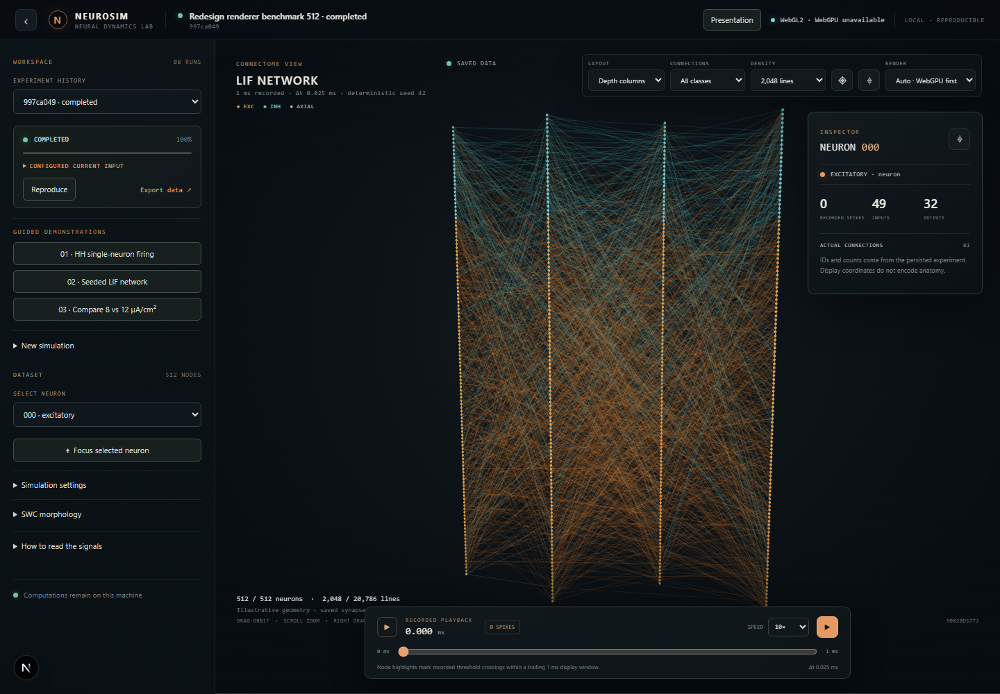
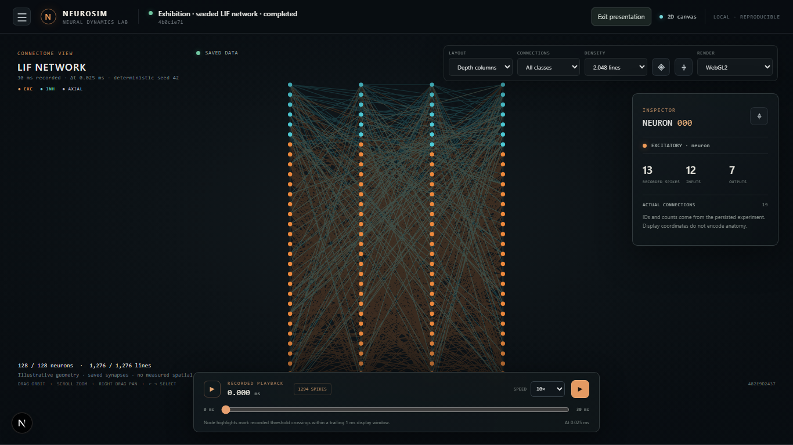
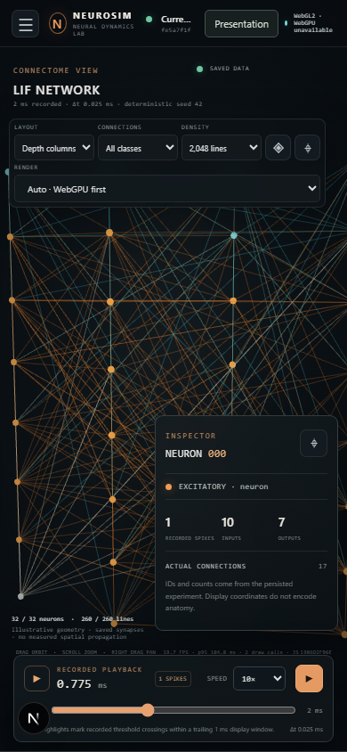

# NeuroSim

NeuroSim is a reproducible computational neuroscience workbench for bounded,
CPU-based neuron and network experiments. It combines a scientific simulation
engine, a persistent FastAPI experiment service, and a browser workbench with
interactive 3D connectivity and time-synchronized analysis.

It is intended for computational experiments and teaching. The validated
workbench does not claim to model a human brain, a specific biological cell
type, clinical physiology, or molecular dynamics. Model assumptions and
numerical limits are part of the [scientific contract](docs/SCIENCE.md).

## Workbench

The visualization uses a real saved network with 512 neurons and 20,786
connections. The default view draws a deterministic 2,048-edge subset; filters,
selection and the inspector refer to saved topology. Orange and cyan encode
excitatory and inhibitory connections. Node placement is an illustrative layout,
not measured anatomy. Recorded spikes drive playback and are synchronized with
voltage traces, raster and population-rate views.



The guided exhibition flow runs real HH and seeded LIF jobs, supports a paired
input comparison, and remains usable in presentation mode at laptop resolution.



The frontend reports the renderer actually initialized. Auto mode uses
WebGPU when a usable adapter is available, otherwise it uses WebGL2. If WebGL2
cannot initialize, the workbench has a batched 2D fallback. These paths are
covered by browser tests; physical-GPU WebGPU performance has not been measured.



Additional browser evidence is available in [`docs/validation/`](docs/validation/).

## Start a local experiment

Requirements: Python 3.11 or newer. For the browser workbench, install Node.js
22 and npm. The documented local validation used Python 3.14 on Windows.

Create an environment and install the package with development tools:

```sh
python -m venv .venv
```

Activate it on Linux/macOS:

```sh
source .venv/bin/activate
```

Or on Windows PowerShell:

```powershell
.venv\Scripts\Activate.ps1
```

Then install NeuroSim:

```sh
python -m pip install --upgrade pip
python -m pip install -e '.[dev]'
```

Start the API in one terminal:

```sh
neurosim serve
```

The local API and original browser client are at http://127.0.0.1:8000; the
interactive API reference is at http://127.0.0.1:8000/docs. To start the Next.js
workbench, use another terminal:

```sh
cd web
npm ci
npm run dev
```

Open http://127.0.0.1:3000. Select a saved experiment or create one from **New
simulation**. Jobs run on the CPU and are saved in SQLite. Set `NEUROSIM_DB` to
choose another database path; use one server worker per database. `NEUROSIM_API_URL`
can point the frontend to a different API and must be set before the frontend
build. This is a single-user local application without remote authentication;
do not expose it to a network without an authenticated, TLS-terminating proxy.

## Models and methods

The supported workbench includes:

- Hodgkin–Huxley membrane dynamics at 6.3 °C with configurable sodium,
  potassium and leak conductances.
- Leaky integrate-and-fire (LIF) and adaptive exponential integrate-and-fire
  (AdEx) neurons.
- Directed seeded networks with excitatory and inhibitory exponential synapses,
  discrete timestep-aligned delays, and recorded threshold crossings.
- A passive sealed cable represented as a chain of 1–32 equal-area compartments.
- Current pulses, Euler and RK4 integration, voltage recording, spike rasters,
  population firing rates and complete experiment manifests.

Default dt is 0.025 ms; HH Euler requires dt ≤ 0.005 ms. Threshold/reset times
are quantized to the integration grid, so reduce dt and compare results for the
scientific question at hand. Resource bounds include 512 network neurons, 2,000
ms duration, 10 million neuron-steps and 32,768 synapses. Parameter limits are
sanity/resource constraints, not a stability proof for every configuration.
The [model contract](docs/SCIENCE.md) gives equations, units, event timing,
solver limitations and the exact validation scope.

The workbench equations and spike conventions are informed by the classical
Hodgkin–Huxley model ([Hodgkin & Huxley, 1952](https://doi.org/10.1113/jphysiol.1952.sp004764))
and the effective AdEx formulation ([Brette & Gerstner, 2005](https://doi.org/10.1152/jn.00686.2005));
the project-specific implementations and restrictions are documented in
[`docs/SCIENCE.md`](docs/SCIENCE.md). These references do not validate arbitrary
parameterizations against experimental data.

## Reproduce and export

Run an example and create a result archive:

```sh
neurosim simulate examples/hh.json --output results/hh.zip
```

The archive includes scientific outputs and a `manifest.json` with parameters,
seed, saved connectivity, units, software/environment metadata and source/config
hashes. Extract the manifest and rerun it with the same engine:

```sh
neurosim simulate results/manifest.json --output results/reproduced.zip
```

Same-environment runs are deterministic. Bitwise identity across Python,
NumPy, operating-system or hardware versions is not guaranteed. Preserve the
manifest and software environment for later analysis. A configuration hash
identifies the manifest configuration; it is not a result checksum.

In the browser, completed experiments can be reloaded, compared, and exported
as ZIP data or SVG plots. Importing an SWC file displays its morphology; it does
not create an electrical cell model. The 3D network layout is not anatomical,
and its connection lines do not represent axons, physical lengths, conduction
velocity or measured signal propagation. Voltage coloring is only available
where recorded compartment voltage is present.

## Validation status

The latest documented local run passed **22 Python tests**, **6 frontend unit
tests**, a strict Next.js production build, and **4 Playwright end-to-end tests**
that execute real simulations through the API. Test coverage and raw outputs are
listed in [`docs/VALIDATION.md`](docs/VALIDATION.md) and the
[web validation report](docs/WEB_VALIDATION_REPORT.md).

Headless Chromium measured WebGL2 at a median 12.0 FPS for 2,048 visible edges
and 2.1 FPS for all 20,786 edges in this 512-neuron graph in the latest run.
This headless result does not establish performance on a physical GPU. Adaptive
display density reduced the edge count but did not reach the 24 FPS target in
the observed sample. WebGPU
had no usable adapter in this environment, so WebGPU and consumer-GPU performance
remain unverified. See the [raw renderer benchmark](docs/validation/web-render-benchmark-redesign.json)
and measured limitations in the [validation report](docs/WEB_VALIDATION_REPORT.md).

Run the Python source tests from the repository root. The explicit
`PYTHONPATH` ensures a source checkout is tested rather than an older installed
copy:

```powershell
$env:PYTHONPATH = 'python'; python -m pytest tests -q
```

```sh
PYTHONPATH=python python -m pytest tests -q
```

Run the frontend checks separately:

```sh

cd web
npm ci
npm test
npm run build
npx playwright install chromium
npm run test:e2e
```

## Deployment and security

For local API use, `docker compose up --build`. To include the web frontend,
run `docker compose --profile web up --build`. Docker configuration is provided,
but local container execution has not been verified because the Docker daemon
was unavailable during validation. Remote CI has not yet been observed green.
CUDA and MPI are not supported or validated by the workbench; no acceleration
or speedup is claimed.

The application has no accounts, TLS or remote authorization. Its SQLite store
is local and is not a distributed queue; network filesystems and multiple API
workers are unsupported. Review [architecture and security notes](docs/ARCHITECTURE.md)
before deployment. The dependency inventory and security scan results are in
[`docs/validation/`](docs/validation/).

The repository has no confirmed project license. Its earlier Apache-2.0 claim
was removed because a matching license file was absent. Do not redistribute
until ownership and license terms are resolved. Version `0.2.0.dev0` denotes
development work, not a released package.

## Documentation map

- [Scientific model contract](docs/SCIENCE.md) — equations, units, solvers,
  reproducibility and scientific interpretation limits.
- [Architecture and security](docs/ARCHITECTURE.md) — services, persistence,
  operations and release gates.
- [Web workbench guide](docs/WEB_WORKBENCH.md) — data endpoints, controls,
  playback, display budgets and browser tests.
- [Implementation audit](docs/IMPLEMENTATION_AUDIT.md) — repository findings
  and remediation evidence.
- [Validation records](docs/VALIDATION.md) — scientific, API, dependency and
  deployment status.
