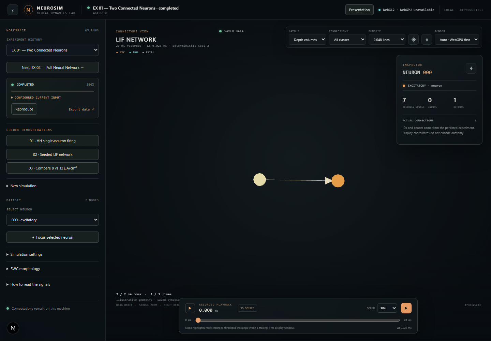
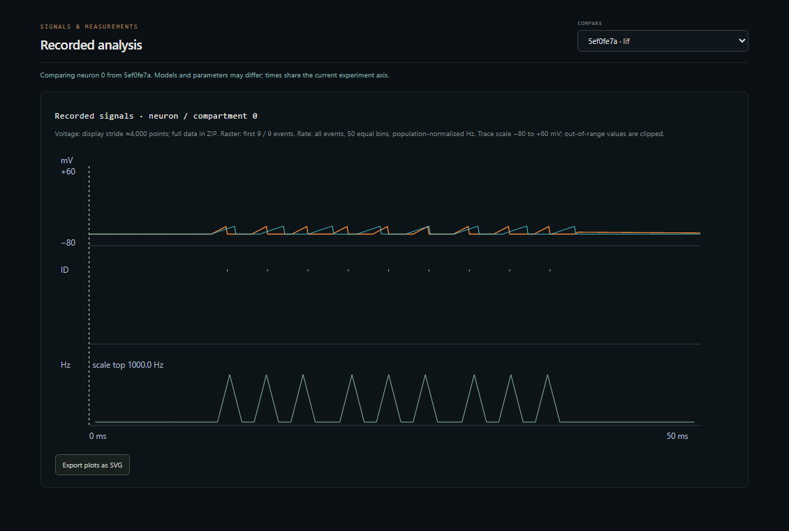

# NeuroSim exhibition demo

This runbook uses the local CPU engine and persisted experiment API. Four
completed runs are pinned in a separate SQLite exhibition index, independent
of creation time. The existing guided actions still submit new CPU jobs. The
exhibition runs are saved results, with original manifests and output retained.

## Presenter click sequence

1. Start the API and frontend, then open <http://127.0.0.1:3000/>. With no
   experiment in the URL, **EX 01 — Two Connected Neurons** opens by default.
   If using an old URL, clear `?experiment=...` first. Open **EXPERIMENT
   HISTORY** to see **EXHIBITION EXPERIMENTS** before **OTHER EXPERIMENTS**.
2. Inspect EX 01's two visible nodes, directed arrow, and one saved excitatory
   edge. Expand **CONFIGURED CURRENT INPUT**: neuron 0 receives 20 µA/cm² for
   `[0,20)` ms. Select neurons 0 and 1 to see their separate voltage traces;
   play or scrub the recorded spikes. The recorded run has 7 and 8 spikes,
   respectively. The display layout and arrow are illustrative; the edge is
   saved model connectivity.
3. Click **Next: EX 02 — Full Neural Network**, or choose EX 02 in history.
   Inspect the 512 neurons and 20,786 saved synapses. The initial view limits
   drawing to 2,048 edges; the stored graph remains complete. Use the edge
   type filter for excitatory and inhibitory connections and select a neuron
   to inspect actual endpoints. This specific 1 ms run recorded **zero
   spikes**, so playback shows no firing activity. Do not narrate firing.
4. Choose **EX 03 — Hodgkin–Huxley Action Potential**. Expand current input:
   10 µA/cm² over `[10,40)` ms. Inspect the 50 ms recorded voltage trace and
   two recorded spikes. The selected neuron is neuron 0.
5. Choose **EX 04 — Stimulus Comparison**. The 12 µA/cm² run is the primary
   entry; the 8 µA/cm² reference is a separate completed run in **OTHER
   EXPERIMENTS**. The comparison selector loads it automatically. Inspect
   both voltage traces in **Recorded analysis** and check the configured
   pulse on each saved job. Both use `[10,40)` ms, 50 ms duration, and seed 42.
6. Refresh the page at EX 04 and confirm the comparison returns. Reopen EX 01
   from history. Use **Presentation** to enlarge the viewport, and **Export
   data** for manifest, voltage, spikes, and connectivity CSVs.

| Entry | Saved job ID | Neurons | Synapses | Recorded spikes |
| --- | --- | ---: | ---: | ---: |
| EX 01 | `b2a94559-f751-4275-a741-e651cab5d349` | 2 | 1 | 15 (7 + 8) |
| EX 02 | `997ca049-c52b-49e4-838c-8dd7acafab5b` | 512 | 20,786 | 0 |
| EX 03 | `4b4be8db-61f3-4c7f-aea0-a862e45ec958` | 1 | 0 | 2 |
| EX 04 (12 µA/cm²) | `7dfedf22-ef59-4262-9abf-9d228cec1776` | 1 | 0 | 9 |
| EX 04 reference (8 µA/cm²) | `d2e40a02-6e62-44c5-8aef-de0e27ec466f` | 1 | 0 | 8 |

These IDs and counts describe the local database prepared on 2026-10-28, not
fixtures shipped in Git. `neurosim-data/experiments.db` is ignored by Git;
back it up with its SQLite WAL files or export each result before moving to
another machine. A fresh clone needs new real runs and exhibition bindings.
The EX 02 record was copied intact from a completed local browser-test SQLite
database after its stored manifest matched the current engine manifest and
its result was checked for 512 voltage series, 20,786 valid edges, and matching
manifest. It was not rerun or renamed.

## First-time Windows setup

Requirements: Python 3.11+, Node.js 22+, npm, and Git. The repository is named
`nuerosim` on GitHub.

```powershell
git clone https://github.com/Shinraya-Tech-Labs/nuerosim.git
Set-Location nuerosim
python -m venv .venv
.\.venv\Scripts\Activate.ps1
python -m pip install -e '.[dev]'
cd web
npm ci
Set-Location ..
```

Keep two PowerShell terminals open. Terminal 1 starts the real API and CPU job
worker:

```powershell
Set-Location .\nuerosim
.\.venv\Scripts\Activate.ps1
neurosim serve
```

Terminal 2 starts the Next.js workbench:

```powershell
Set-Location .\nuerosim\web
npm run dev
```

Open <http://127.0.0.1:3000>. API health is at
<http://127.0.0.1:8000/health>; interactive API docs are at
<http://127.0.0.1:8000/docs>. The application is single-user and local. Keep
both servers on loopback.

## Offline-day checklist

- Complete the setup above while internet access is available; `npm ci` and
  Python package installation need the package cache or network on first use.
- Keep the repository, `.venv`, and `web/node_modules` on the demo machine.
- Start both servers once before the audience arrives and confirm `/health`.
- The workbench uses no hosted fonts, images, login, or cloud API. Browser
  package installation and first build are not offline if dependencies are
  missing.
- Save any important experiments through the UI export link. The default local
  SQLite data lives under `neurosim-data`; set `NEUROSIM_DB` before starting the
  API to choose another database file.

## Recovery

- **Port 3000 busy:** in Terminal 2 run `npm run dev -- --port 3001`, then open
  <http://127.0.0.1:3001>.
- **Port 8000 busy:** stop the other process if appropriate. Otherwise start
  the API on another loopback port with
  `python -m uvicorn neurosim.workbench.api:app --host 127.0.0.1 --port 8001`.
  Before starting Next.js, set `$env:NEUROSIM_API_URL='http://127.0.0.1:8001'`.
- **Python import or command failure:** activate `.venv`, return to the repo
  root, and run `python -m pip install -e '.[dev]'`. Use `python -m uvicorn ...`
  as shown above if the `neurosim` script is not on PATH.
- **npm dependency failure:** from `web`, run `npm ci` with access to the
  package cache or registry. Do not update package versions during setup.
- **API unavailable in UI:** check Terminal 1 and open `/health`; confirm the
  UI rewrite points to the same API port. Look for the UI's API error state.
- **Slow 3D view:** use the viewport controls to select a lower edge budget or
  2D fallback. The 512-neuron case has 20,786 saved connections; the view is
  bounded to 2,048 by default. This does not reduce the saved scientific data.
- **Renderer unavailable:** check the renderer badge. Auto mode tries WebGPU
  only when supported, then WebGL2; failure falls back to 2D canvas. Do not
  interpret node placement or animated highlights as anatomy or propagation.
- **No saved runs:** start a guided experiment; successful results persist in
  SQLite. If changing `NEUROSIM_DB`, use the same path on every API restart.
- **Return to last known good source:** `git log --oneline` to identify the
  desired commit, then create a recovery branch with
  `git switch -c recovery/<name> <commit>`. Do not reset a branch with local
  changes.

## Three-minute demonstration

### 30-second introduction

“NeuroSim is a local, reproducible workbench for bounded neuron and network
experiments. The browser is showing topology and activity saved by the CPU
simulation service. Each run carries its configuration and random seed. The
network layout is a visual aid rather than anatomy; the plots and spike events
come from the saved simulation.”

### Timed sequence

| Time | Action and narration |
| --- | --- |
| 0:00–0:40 | Open EX 01. Show the 0→1 excitatory edge, both neuron traces, and recorded spikes. |
| 0:40–1:25 | Click Next to EX 02. Show the 512/20,786 counts, 2,048 initial drawn edges, type filter, and inspector. State that this run has zero spikes. |
| 1:25–2:05 | Choose EX 03. Show the configured HH pulse, voltage graph, and raster. |
| 2:05–2:45 | Choose EX 04. Show the automatic overlay of the saved 8 and 12 µA/cm² traces. Refresh and verify it persists. |
| 2:45–3:00 | Export a result or show its manifest and seed. State model and layout limitations. |

The guided configurations are named “Exhibition · HH current clamp”,
“Exhibition · seeded LIF network”, and “Exhibition · LIF pulse 8/12 µA/cm²”.
Their settings are respectively: HH, one neuron, 50 ms, `dt=0.025 ms`, seed 42,
10 µA/cm² over `[10,40)` ms; LIF, 128 neurons, connection probability 0.08,
seed 42, 30 ms, with 16 neurons receiving 20 µA/cm² over `[0,30)` ms; and two
single-neuron LIF runs, 50 ms, `dt=0.025 ms`, seed 42, with the one changed
parameter set to 8 or 12 µA/cm² over `[10,40)` ms. They create real jobs.
Expected output types are recorded voltage, spike events, saved topology,
metadata, and derived population-rate bins; counts below are from actual runs,
not values hardcoded into the visualization.

## Judge questions

1. **Are these measurements from a brain?** No. They are numerical outputs of
   documented simplified models; no experimental dataset is shown.
2. **Is the 3D arrangement anatomical?** No. It is a deterministic illustrative
   layout. Saved directed edges are genuine model connectivity.
3. **What makes a run reproducible?** The manifest records parameters, seed,
   input pulses, configuration hash, saved connectivity, and software metadata.
4. **Does playback invent spikes?** No. Highlights are derived from saved spike
   timestamps and the selected simulation time.
5. **What do orange and cyan mean?** Saved excitatory and inhibitory synapse
   classes, respectively.
6. **Why do traces jump at spikes?** LIF uses a threshold/reset rule and the
   solver's threshold events are quantized to the integration timestep.
7. **What is the comparison changing?** The guided comparison changes only the
   configured LIF input pulse amplitude; both jobs are independently run.
8. **Does the cable use the uploaded SWC geometry?** No. The bounded passive
   cable is a chain of equal compartments. SWC import is a morphology display.
9. **Does this run on a GPU?** The scientific jobs use the CPU. Renderer badge
   reports the browser renderer; GPU acceleration of the simulation is not
   claimed.
10. **Can it model a whole brain or clinical physiology?** No. The engine is
    resource-bounded and has not been clinically validated.

## Verification and rehearsal record

Last source baseline before this exhibition change: commit `458c99b` on branch
`codex/neurosim-research-readme`. The exhibition work is on branch
`exhibition-2026-10-28`. Latest observed upstream CPU and web CI workflows passed
at `69a258c` on 2026-10-27; that CI result does not validate this local change.

Local results on 2026-10-27: Python `pytest tests -q` passed **22 tests** with
one Starlette/httpx deprecation warning; `npm test` passed **6 tests**;
`npm run build` passed its production compilation and TypeScript checks;
`npm run test:e2e` passed **4/4** including the 512-neuron benchmark. The guided
browser test also passed on a separate clean run. One real seeded-network run
recorded 128 neurons, 1,276 saved edges and 1,284 spike events; the result is
stored by that test run rather than hardcoded in the UI. The latest benchmark
sampled the active renderer as WebGL2, with no usable WebGPU adapter. It measured
median 12.0 FPS at 2,048 edges and 2.1 FPS at all 20,786 edges; the environment
is headless and does not measure exhibition-hardware performance. The real
1366×768 screenshot is `docs/validation/exhibition-workspace.png`.

On 2026-10-28, this exhibition change passed **23 Python tests** (one
Starlette/httpx deprecation warning), **6 frontend unit tests**, a Next.js
production build with TypeScript checks, and **5/5 browser tests**. The new
browser test exercised the actual API worker and saved database, verified EX
01's stored 0→1 excitatory edge, ordered labels, default loading, navigation,
and EX 04 overlay after reload. The full browser suite also exercised a real
512-neuron network at 2,048 and all 20,786 visible edges. The local live
workbench displayed EX 01 under WebGPU at roughly 42–52 FPS in a brief
observation; that is not a controlled benchmark. EX 02 device performance was
not measured in this setup.





See `docs/validation/web-render-benchmark-redesign.json` and
`docs/WEB_VALIDATION_REPORT.md` for renderer context and raw samples.
Exhibition-device performance and WebGPU performance are unmeasured. No
speedup is claimed.

### Presenter dry run — manually tick only after rehearsal

- [ ] Start API and UI from a fresh login.
- [ ] Confirm health endpoint and renderer badge.
- [ ] Select EX 01; inspect both recorded neuron traces and the 0→1 edge.
- [ ] Select EX 02; verify 512/20,786 totals and zero recorded spikes.
- [ ] Select EX 03; inspect HH voltage, raster, and pulse metadata.
- [ ] Select EX 04; verify both saved runs and the automatic overlay.
- [ ] Pause, scrub, resume, select a neuron, and export results.
- [ ] Refresh and reopen a completed run from history.
- [ ] Confirm 1366×768 layout and test a narrow viewport.
- [ ] Check the 2D fallback on a browser/device without usable WebGL2.
- [ ] Disconnect internet and verify the prepared machine still runs locally.
